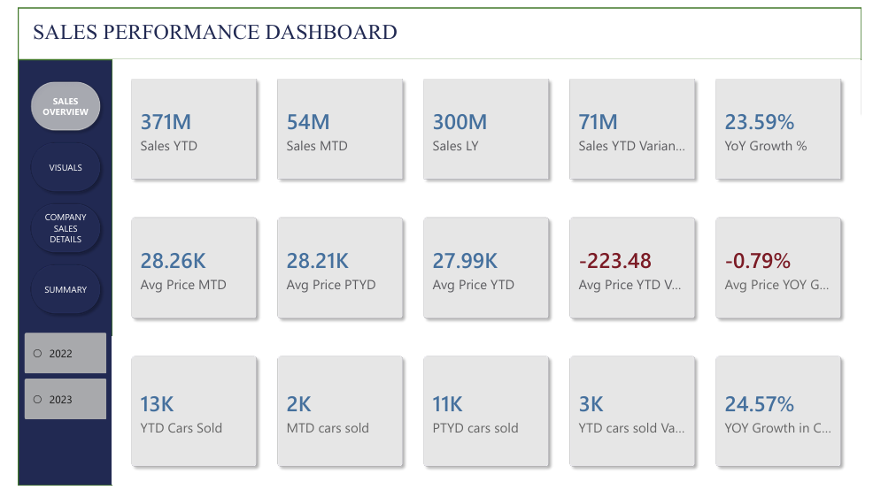
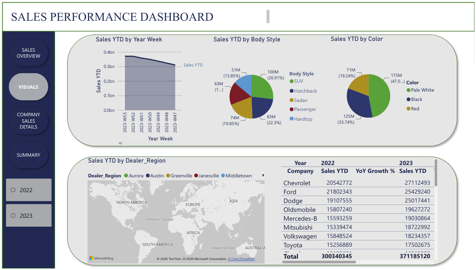
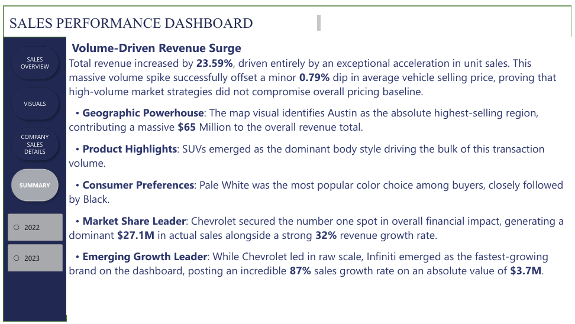

# Car Sales Performance Dashboard

An interactive **Power BI** report that analyses vehicle sales by company, body style, colour and dealer region, and tracks revenue, average price and units sold against the prior year using **DAX time intelligence**.

> *Built during my Data Analyst Programme at Dxpertz Computer Technology.*

> **Business question:** Where is sales growth coming from, and did it come at the cost of price?
> **Answer:** Revenue grew **23.59%** on **24.57%** more cars sold, while average price slipped only **0.79%**. Growth was volume-driven, not discount-driven.

## Key findings

| Metric | Result |
|---|---|
| Sales YTD vs last year | **$371M** vs **$300M** (+23.59%) |
| Cars sold YTD vs prior year | **13K** vs **11K** (+24.57%) |
| Average price YTD | **$27.99K** vs **$28.21K** prior year (-0.79%) |
| Top region | **Austin**, about **$65M** in sales |
| Top company | **Chevrolet**, **$27.1M** (+32%) |
| Fastest-growing brand | **Infiniti**, **+87%** on **$3.7M** |
| Top body style | **SUV** (about 27% of sales) |
| Top colour | **Pale White**, followed by Black |

## Dashboard pages

| Page | What it shows |
|---|---|
| **Sales Overview** | KPI cards for sales, average price and cars sold: YTD, MTD, prior year, variance and YoY growth, with a year slicer |
| **Visuals** | Sales by body style and colour, a company-by-year matrix with YoY growth, a weekly sales view and a regional map |
| **Company Sales Details** | Transaction-level detail table *(not shown here: contains customer-level fields)* |
| **Summary** | Written executive summary of the main insights |

## Data model

- **Fact table:** `car_data`, one row per car sale (company, model, body style, colour, engine, transmission, dealer, region, date, price)
- **Date table:** `Calendar`, used for year-to-date, month-to-date and prior-year comparisons

## DAX measures built

- **Sales:** YTD, MTD, last year, YTD variance, YoY growth %
- **Average price:** MTD, YTD, prior-year-to-date, YTD variance, YoY growth %
- **Cars sold:** YTD, MTD, prior-year-to-date, YTD variance, YoY growth %

## Skills demonstrated

Power BI report design and navigation, DAX time intelligence, data modelling with a date table, KPI and variance design, sales and pricing analysis, and business storytelling. My accounting background shaped how I handled the variance and growth metrics.

## Quick read

A two-page summary with the key findings and report structure is in [`docs/Car_Sales_Dashboard_Project_Summary.pdf`](docs/Car_Sales_Dashboard_Project_Summary.pdf).

## About the data

The dataset was provided by my instructor as part of the programme and is believed to be synthetic. Customer-level fields (names, phone numbers, income) are intentionally excluded from the screenshots and summary in this repository.

## Tools

Power BI Desktop, DAX

## Contact

**Douglas Ogieva** | Benin City, Nigeria | [LinkedIn](https://www.linkedin.com/in/douglasogieva) | [Email](mailto:douglasogieva14@gmail.com)
